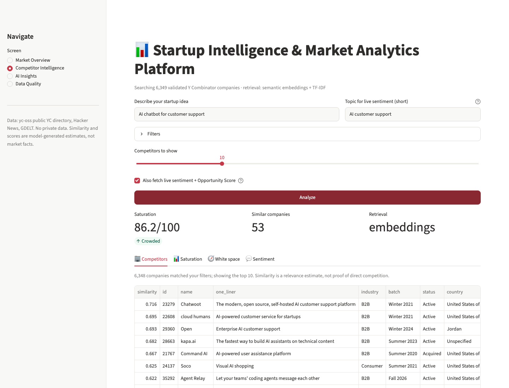
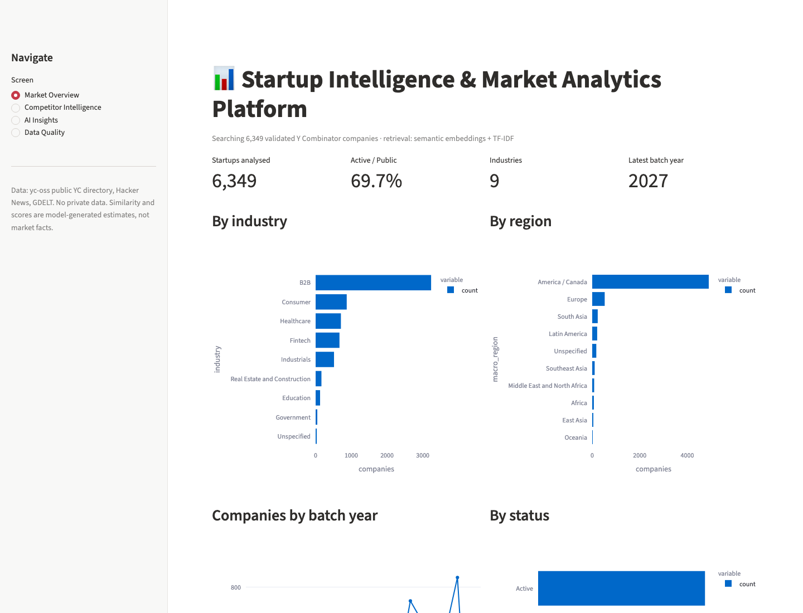
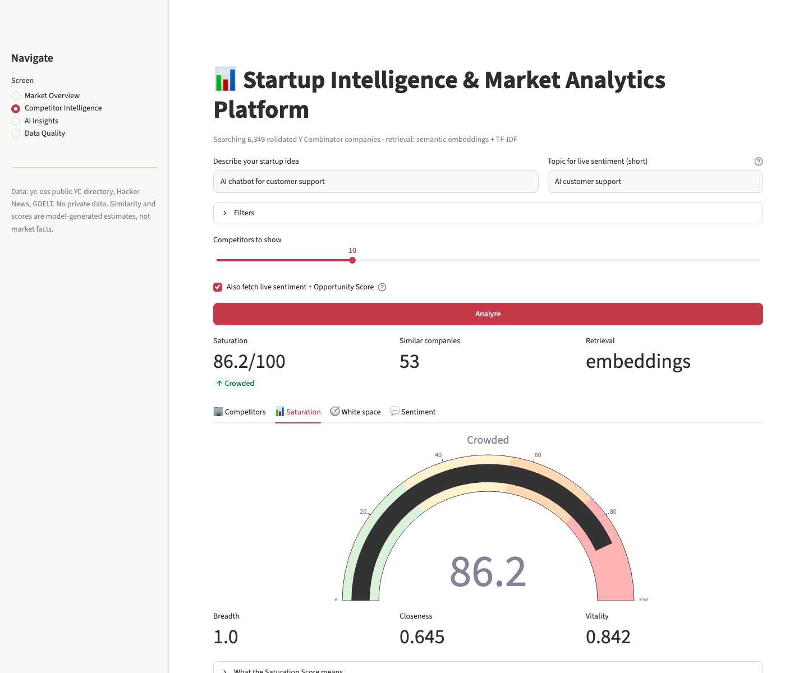
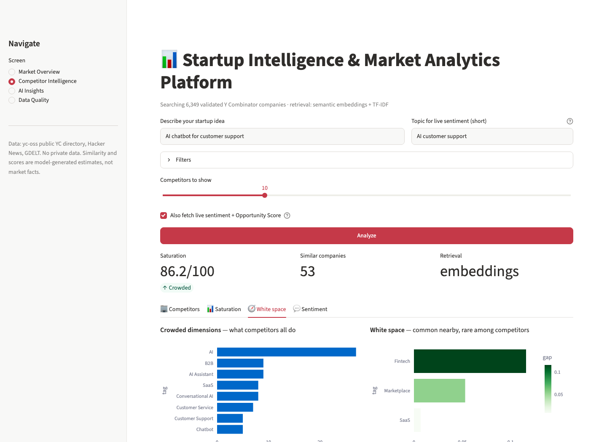
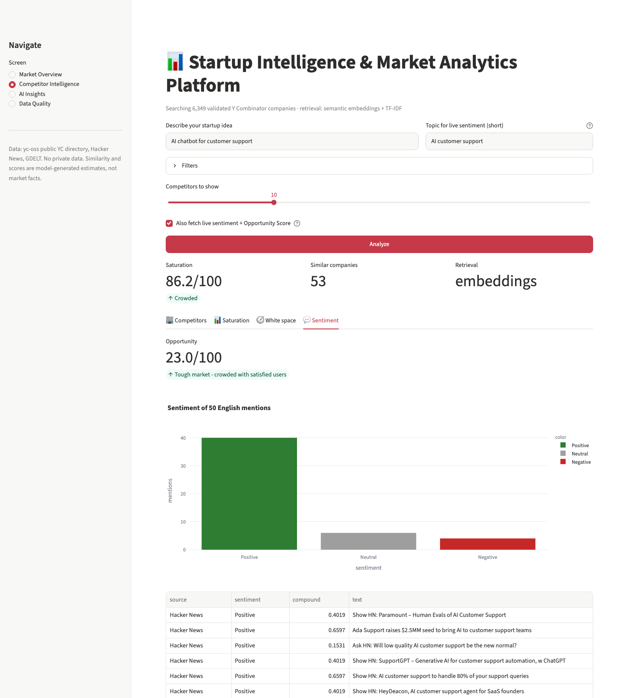
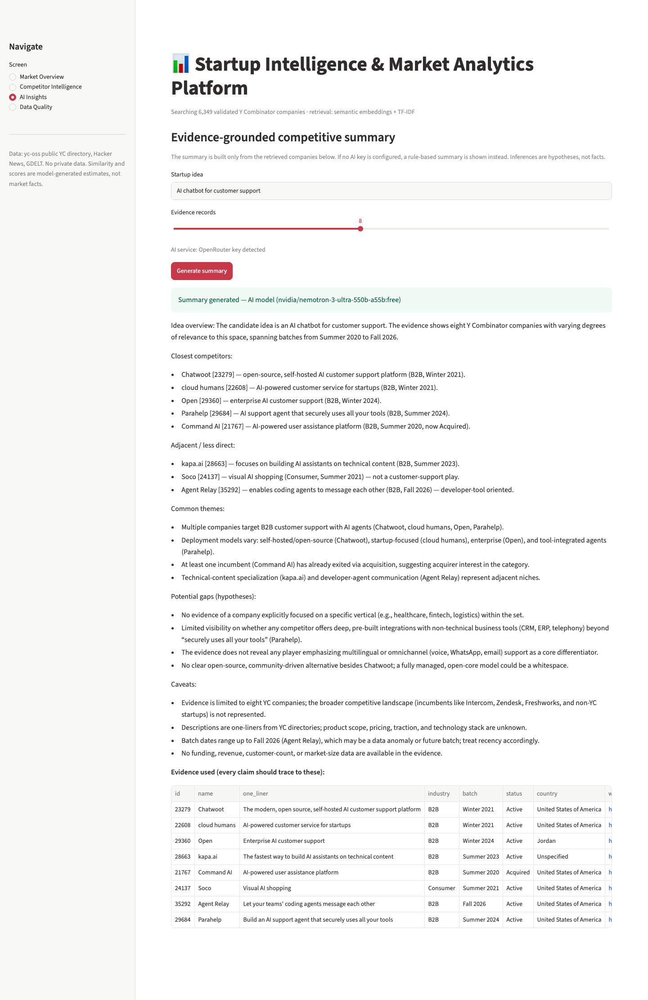
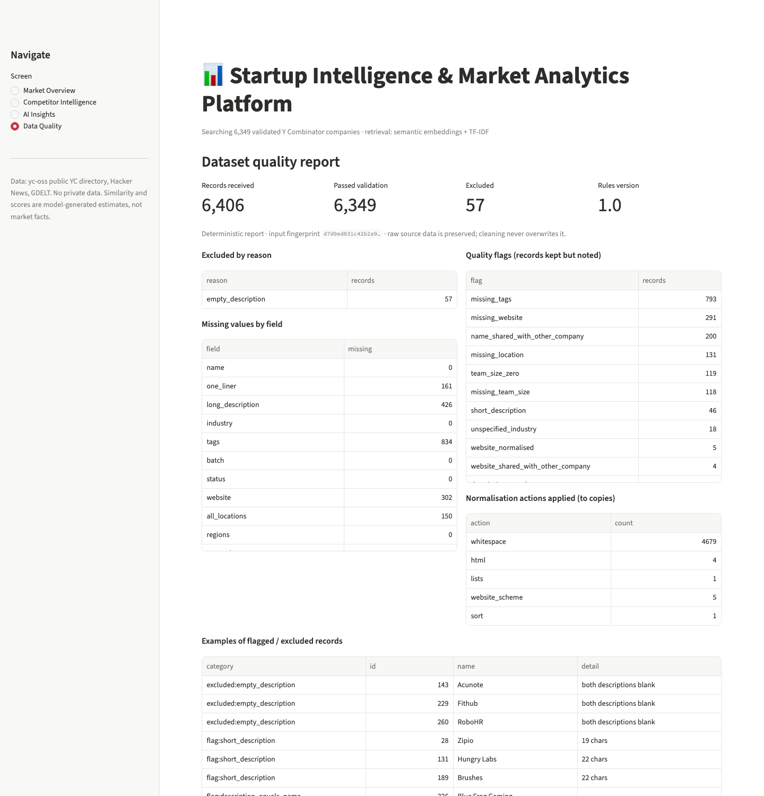

# 📊 Startup Intelligence & Market Analytics Platform

*An NLP-powered decision-support application for competitor discovery, market analysis, and
evidence-based opportunity assessment.*

Type a startup idea and get its closest Y Combinator competitors, how crowded the space is, live
community/news sentiment, a differentiation (white-space) view, and an optional evidence-grounded AI
summary — with data-quality validation and tests behind it. All outputs are explainable estimates
over a public dataset, not objective market facts.

> Run it locally in a few commands: see [Setup & execution](#11-setup--execution). Full
> documentation is in [`docs/`](docs/), starting with the [User Guide](docs/User_Guide.md).

<!-- TODO: add the Streamlit Cloud link here as "Live demo: <url>". -->

[](LICENSE)



## 1. Project overview
A four-screen Streamlit app (Market Overview, Competitor Intelligence, AI Insights, Data Quality)
built on ~6,300 validated Y Combinator startups, using semantic-embedding and TF-IDF retrieval, a
custom saturation metric, multi-source sentiment, and an optional grounded LLM summary.

## 2. Business problem
Manually searching a large startup dataset to understand a competitive landscape is slow and
inconsistent, and gives no sense of how crowded or active a space is. See
[Business Requirements](docs/Business_Requirements.md).

## 3. Proposed solution
Searchable NLP matching + structured analytics + explainable scoring + a validated data pipeline,
delivered as a documented, tested web app.

## 4. Key features
- Competitor search with similarity scores and filters (industry, status, region, stage, batch year).
- Market Overview: distributions plus category density and momentum indicators.
- Market Saturation score with an in-app explanation and limitations.
- Opportunity score that combines saturation with live sentiment.
- White-space / differentiation finder.
- Data-quality validation with a deterministic report (raw data preserved).
- Optional evidence-grounded AI summary (OpenRouter) with a rule-based fallback.

## 5. Architecture & technology stack
Python · pandas · scikit-learn (TF-IDF, cosine similarity) · sentence-transformers
(`all-MiniLM-L6-v2`) · vaderSentiment · Plotly · Streamlit · pytest.

Logic lives in `src/`, `app.py` handles the UI, and search artifacts are precomputed.

```text
yc-oss data → validation & cleaning → TF-IDF + embeddings
                                            ↓
        your idea + filters → competitor search → scoring → optional AI summary → app
```

See [Process Flow](docs/Process_Flow.md) for the full workflow and component responsibilities.

## 6. Dataset description & limitations
The public [`yc-oss`](https://github.com/yc-oss/api) Y Combinator directory (company metadata).
The bundled app data was built from 6,406 records, of which 6,349 pass validation.

The data covers YC companies only, so absolute counts understate real markets, and text similarity
can miss competitors that describe themselves differently.

## 7. Data validation methodology
Documented checks, cleaning rules, exclusion and flag logs, and a deterministic fingerprinted
report. In the bundled data, 57 records are excluded for having no usable description. Records
with lesser issues (such as missing tags or website) are kept and flagged. Raw data is never
overwritten. See [Data Validation](docs/Data_Validation.md).

## 8. Search & scoring methodology
**Competitor search** ranks companies by cosine similarity, using MiniLM embeddings when available
and falling back to TF-IDF otherwise.

**Saturation (0–100)** measures how crowded a space is. It is always computed from TF-IDF similarity:

`100 × (0.5 × breadth + 0.3 × closeness + 0.2 × vitality)`

| Input | Meaning |
|---|---|
| Breadth | Number of companies with similarity ≥ 0.08, capped at 50 |
| Closeness | Mean similarity of the 5 nearest companies, where 0.40 or more counts as maximum |
| Vitality | How many matched companies are still operating, weighted by status |

Bands: 0–30 Wide open · 30–55 Emerging · 55–75 Competitive · 75–100 Crowded.

**Opportunity (0–100)** is an equal-weight average of openness and dissatisfaction:

`100 × (0.5 × (1 − saturation / 100) + 0.5 × dissatisfaction)`

Dissatisfaction is `(1 − average VADER compound score) / 2` over English mentions from Hacker News
and GDELT news, and defaults to 0.5 if there are none.

**White space** lists tags that are common in the surrounding industries but rarer among the 40
closest competitors.

All weights and thresholds are hand-set design choices, not learned from outcomes.

## 9. Testing & validation approach
`python -m pytest` runs 29 tests covering data validation, search and ranking, filters, analytics,
and AI grounding and fallback. The test suite does not cover the Streamlit UI. See
[Test Cases](docs/Test_Cases.md) and [Results & Validation](docs/Results_and_Validation.md).

## 10. The four screens
| Screen | What you do there |
|---|---|
| Market Overview | See distributions and category density/momentum across ~6,300 YC startups |
| Competitor Intelligence | Describe an idea (with optional filters) and explore four tabs: Competitors (ranked, with similarity), Saturation (score plus breadth, closeness and vitality), White space, and Sentiment (live sentiment and an Opportunity score, switched on by a checkbox) |
| AI Insights | Read an evidence-grounded competitive summary (OpenRouter, or a rule-based fallback) |
| Data Quality | Inspect the dataset quality report: records excluded by reason, and records kept but flagged |

Step-by-step usage is in the [User Guide](docs/User_Guide.md).

The screenshots below use the example idea *"AI chatbot for customer support"*. Live sentiment and
AI-written text change from run to run.

### Market Overview


### Competitor Intelligence
The ranked **Competitors** tab is shown at the top of this page.

#### Saturation


#### White space


#### Sentiment & Opportunity


### AI Insights


### Data Quality


## 11. Setup & execution
Tested with Python 3.12. The prepared data is included in `data/`, so no build step is needed.

```bash
git clone https://github.com/aishwar-mr/startup-intelligence.git
cd startup-intelligence
python -m venv .venv
source .venv/bin/activate          # Windows: .venv\Scripts\activate
pip install -r requirements.txt
streamlit run app.py               # opens http://localhost:8501
```

The first run downloads the embedding model.

```bash
python -m pytest                   # run the test suite
python build_artifacts.py          # optional: fetch fresh YC data and rebuild data/
```

Add `--no-embeddings` to the build command for a lighter, TF-IDF-only build.

### Enabling AI summaries (optional)
Without a key, summaries are rule-based. To use a model, create a key at
[openrouter.ai](https://openrouter.ai) and add it to `.streamlit/secrets.toml` (git-ignored) for
local runs, or to the app's **Secrets** settings on Streamlit Cloud:

```toml
OPENROUTER_API_KEY = "your-key-here"
# OPENROUTER_MODEL = "<model-id>"   # optional: choose the first model to try
```

You can also set these as environment variables. The app uses free models by default, tries
fallbacks if one is unavailable, and shows a rule-based summary if none responds.

## 12. Known limitations & future improvements
**Limitations**
- YC-only corpus.
- Sentiment is scored for English text only.
- Live sentiment and AI summaries depend on external services that can be slow or rate-limited.
- AI summaries can be wrong; check claims against the evidence table.

**Future improvements:** multilingual sentiment; a broader corpus (Crunchbase, Product Hunt);
learned saturation weights; trend detection over time; approximate-nearest-neighbour search for
scale.

## Repository layout
```
startup-intelligence/
├── app.py                 # Streamlit UI (4 screens)
├── build_artifacts.py     # validate + build TF-IDF/embeddings/report
├── requirements.txt
├── CHANGELOG.md
├── LICENSE
├── src/                   # preprocess, validation, resources, retrieval,
│                          # saturation, analytics, whitespace, sentiment, insights
├── tests/                 # pytest suite
├── docs/                  # requirements, user stories, process flow, test cases,
│   └── screenshots/       # results, data validation, user guide, screenshots
└── data/                  # prepared artifacts + validation logs
```

## License
Released under the [MIT License](LICENSE).
